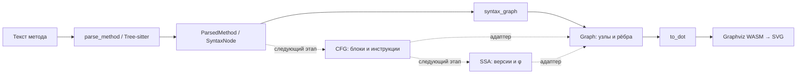

# Архитектура и расширение

## Границы компонентов



Три слоя ядра: синтаксис, представление для отображения, протокол.
В ядре нет HTTP, процессов Node.js, Graphviz API или состояния редактора.
`lab_core` можно подключить к другому C++ приложению без CLI.

Tree-sitter возвращает concrete syntax tree. Обход именованных узлов даёт
компактный вид, удобный для AST-ориентированных алгоритмов, но не создаёт
семантическое AST и не разрешает имена. Не стоит считать строковое имя
переменной уникальным символом во всей программе.

## API C++

```cpp
#include <lab/graph.hpp>

auto result = lab::parse_method("int F(int x) { return x + 1; }");
if (result.ok()) {
    auto root = result.method->root();
    auto name = root.field("name").text();
    auto body = root.field("body");
    for (auto statement : body.children(true)) {
        // statement.kind(), statement.text(), statement.range()
    }
    auto graph = lab::syntax_graph(*result.method);
    auto dot = lab::to_dot(graph);
}
// result.diagnostics доступен и при наличии частичного дерева.
```

`ParsedMethod` владеет текстом и `TSTree` и не копируется/не перемещается.
`ParseResult` хранит его через `unique_ptr`: перемещение результата не
инвалидирует узлы. `SyntaxNode` и возвращаемые `string_view` — невладеющие
представления; их нельзя сохранять дольше владельца.

`field(name)` возвращает узел с `valid() == false`, если поле отсутствует.
`children()` включает токены; `children(true)` — только именованные узлы.
`child_field(i)` возвращает имя поля либо пустую строку. Для будущего
понижения выражений важно сохранять операторы: они могут быть анонимными
токенами. JSON-export содержит все дочерние узлы, их поля и текст листьев.

Внутри добавляется `class __LabInput__ {\n` и завершающая скобка. Проверяется
именно один метод в теле класса и отсутствие других членов. Полное дерево
проверяется на `ERROR`/`MISSING`, включая синтетическую часть: иначе добавленная
скобка могла бы замаскировать незакрытое тело метода. Если метод восстановлен,
он экспортируется с диагностикой; если нет — `dot`/`tree` равны `null`.

Ограничения для интерактивного прототипа: 256 KiB исходника, 256 уровней
вложенности дерева. Превышение глубины даёт диагностику и усечённый экспорт.
Это ограничения приложения, а не грамматики C#.

## Координаты

Все `range` — полуоткрытые `[start, end)` **смещения в байтах UTF-8** в
пользовательском исходнике. Смещения служебного класса вычитаются, позиции
за пределами ввода ограничиваются началом/концом ввода. Поэтому диагностика
пропущенного токена в конце метода может иметь нулевую длину на EOF.

C++ сохраняет CRLF. Viewer отправляет именно текст своей модели и использует
его для перевода UTF-8 в UTF-16 (`byteToUtf16`), затем получает позиции Monaco.
Позиции не сравниваются с текстом от другой ревизии. Node ID детерминированы
для одного дерева, но не являются постоянными идентификаторами между правками.

## Протокол v1

`lab-model --request-json`: один JSON на stdin до EOF, один JSON на stdout,
затем завершение процесса. `POST /api/analyze` передаёт тот же запрос:

```json
{
  "protocolVersion": 1,
  "requestId": 12,
  "source": "int F() { return 1; }",
  "view": "syntax"
}
```

Ответ:

```json
{
  "protocolVersion": 1,
  "requestId": 12,
  "status": "ok",
  "diagnostics": [],
  "dot": "digraph Syntax { ... }",
  "nodeRanges": { "n0": { "start": 0, "end": 21 } }
}
```

Статусы: `ok` / `syntax_error` / `error`. Диагностика:
`{code, message, range: {start, end}}`; все текущие диагностики — ошибки.
В `syntax_error` может присутствовать частичный DOT. В `error` DOT равен
`null`. Неразбираемый JSON возвращает `requestId: null`. Файловый JSON-export
дополнительно содержит `tree`, а его `requestId` равен `null`.

Неподдерживаемый `view`, включая `cfg` и `ssa`, возвращает `unsupported_view`,
а не фиктивный результат. Для подключения будущей модели понадобится добавить
её в диспетчер анализа и UI; транспорт и DOT-renderer остаются теми же.

HTTP-ошибки: `400` — неверный конверт, `413` — большой исходник,
`415` — неверный Content-Type, `502` — сбой/таймаут дочернего процесса.
Успешная передача ответа CLI использует HTTP 200, в том числе для диагностик
и `unsupported_view`; смотрите поле `status`. Транспортные ошибки имеют
форму `{error: "..."}`. `GET /api/examples` возвращает `{name, source}[]`.

Node.js запускает только настроенный бинарник с фиксированным аргументом,
не использует shell. Ограничения: 2 MiB JSON-запрос, 32 MiB ответа процесса,
5 секунд на анализ. Закрытие HTTP-ответа до завершения отменяет процесс.
При завершении сервера активные процессы отменяются.

Viewer увеличивает ревизию сразу при правке, до debounce, отменяет запрос
и старый Graphviz worker. Проверяет ревизию после HTTP и после рендера.
Graphviz ограничен 15 секундами. Пока граф устарел, экспорт и переход
из него к исходнику отключены. Частичное дерево явно подписано.

## Следующий этап: CFG и SSA

Целевой начальный подъязык: параметры/локальные `int` и `bool`, блоки,
арифметические и логические выражения, присваивания, `if/else`, `while`,
`for`, `do/while`, `break`, `continue`, `return`. Сам парсер понимает более
широкий синтаксис: успешный разбор не является обещанием поддержки CFG/SSA.

Будущие модели должны хранить семантику отдельно от отображения:

- CFG: идентификаторы базовых блоков, инструкции, терминаторы и переходы;
  предусмотреть разные цели `break` и `continue`, ранний `return` и короткое
  замыкание `&&`/`||`.
- Связывание имён: отдельный SymbolId для каждого объявления с учётом
  областей видимости; нельзя подменять это сравнением подписей узлов.
- SSA: значение как SymbolId + версия, φ с аргументами, привязанными к
  предшествующим BlockId. Названия и форматирование — задача отображения.
- Адаптеры CFG/SSA → `Graph`: можно менять подписи/стиль, не меняя
  алгоритмы. `Graph` не является хранилищем семантики программы.

Здесь намеренно нет реализаций построителей CFG/SSA, анализа типов,
модели памяти или вызовов.

## Почему эти зависимости

Tree-sitter встраивается как C-библиотека с готовым парсером. Roslyn потребовал
бы .NET-компонента и отдельной передачи дерева в C++; ANTLR добавил бы этап
генерации и проверку зависимых от target действий грамматики. Web-viewer
позволяет использовать готовый редактор и SVG; нативные GUI-библиотеки,
WebView-упаковка, KMP и серверная установка Graphviz не требуются.
